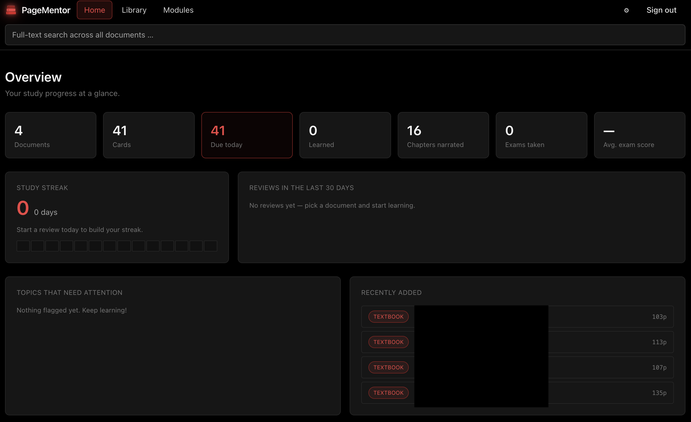
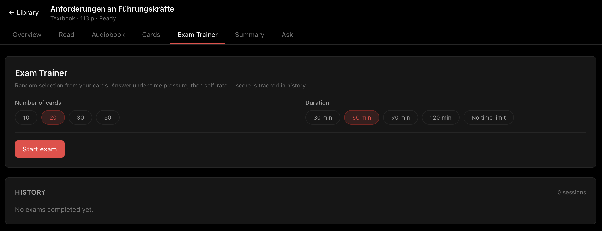
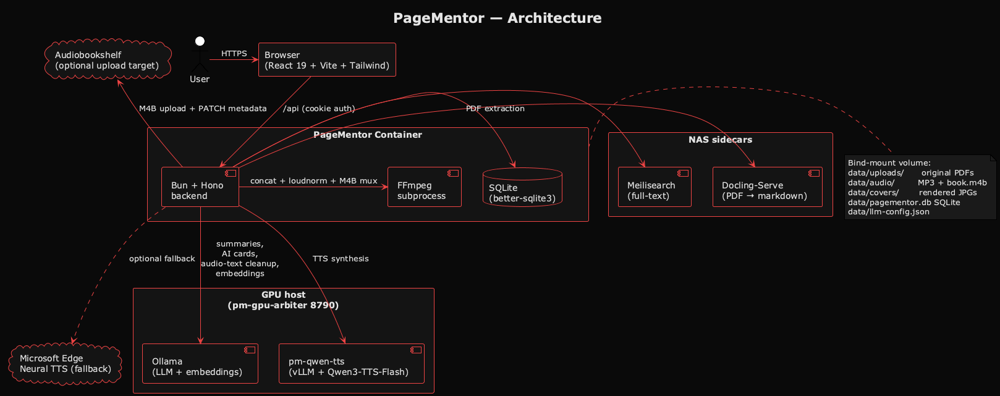
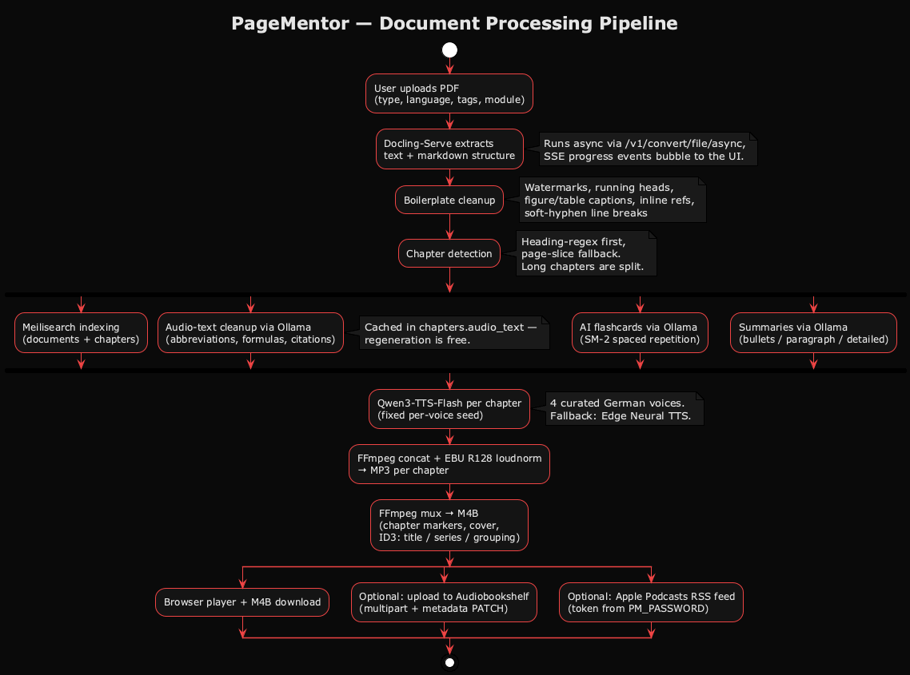
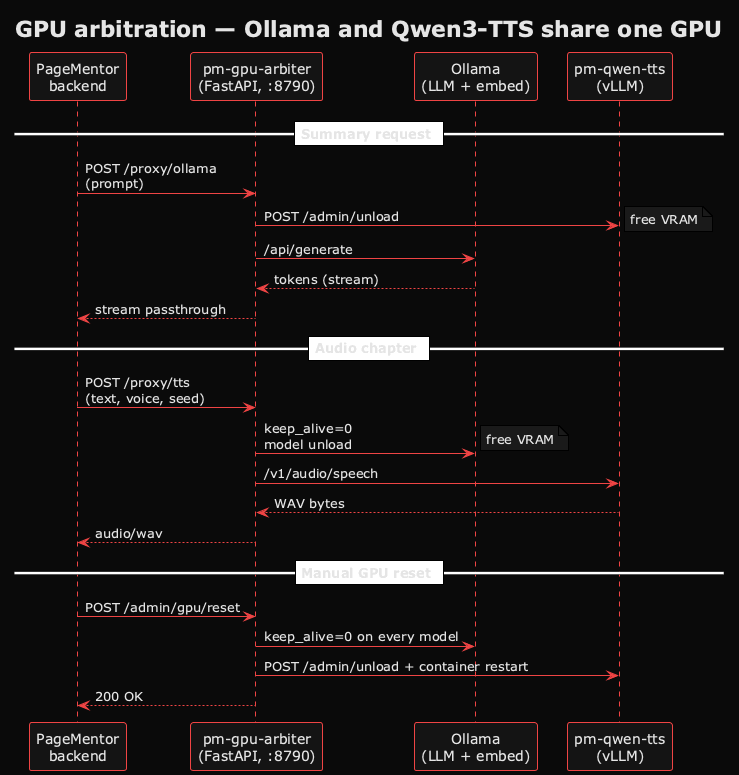

# PageMentor

> **Self-hosted study companion.** Drop in a lecture PDF and get an
> **audiobook, flashcards, exam-trainer sessions, summaries and full-text
> search** — 100 % local, on your own hardware, no cloud account and no
> API credit required.


*Tags: self-hosted · audiobook generator · PDF to M4B · Qwen3-TTS · Docker ·
Synology · Audiobookshelf · spaced repetition · local LLM · Ollama*

> **Note:** Personal hobby project for data-obsessed self-hosters. Not
> intended for commercial use, no warranties, no support guarantees.

## Screenshots

| Library (grid + filters)                            | Learning menu (doc overview)                         |
| --------------------------------------------------- | ---------------------------------------------------- |
|             |  |

| Audiobook panel (Qwen3-TTS)                         | Summaries (three detail levels)                      |
| --------------------------------------------------- | ---------------------------------------------------- |
|         |            |

| Flashcards + SM-2 review                            | Exam trainer                                         |
| --------------------------------------------------- | ---------------------------------------------------- |
|            |            |

| Full-text search overlay                            | Settings (LLM + TTS + ABS)                           |
| --------------------------------------------------- | ---------------------------------------------------- |
|               |            |

## Architecture



Source: [`docs/diagrams/architecture.puml`](docs/diagrams/architecture.puml).
Render with `plantuml -tpng docs/diagrams/architecture.puml -o ../screenshots`.

### Document processing pipeline



Source: [`docs/diagrams/pipeline.puml`](docs/diagrams/pipeline.puml).

### GPU arbitration (Ollama ↔ Qwen3-TTS on one card)



Source: [`docs/diagrams/gpu-arbiter.puml`](docs/diagrams/gpu-arbiter.puml).

## Features

- **Library** — card grid with type/tag/module filters, pipeline-dot
  dashboard per document (text → chapters → audio → cards → summary),
  live SSE status, cover rendered from any page you choose.
- **Modules & tags** — organise by module (series) + free-form tags,
  instead of a folder tree.
- **PDF viewer** — continuous scroll, zoom, page jump, text-selection →
  flashcard.
- **Chapter detection** — heading heuristic + page-slice fallback, long
  chapters auto-split, inline editor (rename, merge, delete).
- **Audio cleanup** — two-stage. Extractor strips watermarks, running
  heads, figure/table captions and inline references. Then a local LLM
  (Ollama) rewrites for narration: expands abbreviations, verbalises
  formulas and Greek letters, strips citations, removes bullet markers.
  Cached per chapter (`chapters.audio_text`) — regeneration is free.
- **Audiobook (Qwen3-TTS)** — default engine is
  [Qwen3-TTS-Flash](https://huggingface.co/Qwen/Qwen3-TTS-Flash) served
  via vLLM behind `pm-gpu-arbiter` (Apache 2.0, fully local,
  university-/company-safe). Four curated German presets
  (Anna / Emma / Klaus / Max) with fixed per-voice seeds — same voice
  always sounds identical across runs. Additional preset-voice slots
  (CustomVoice) and text-described voices (VoiceDesign) are editable
  from the Settings modal.
- **Voice cloning (optional)** — upload a 3–10 s reference clip and the
  Qwen-Base path clones the voice; cached in the sidecar for stable
  narrator quality across chapters.
- **Audiobook (Edge fallback)** — Microsoft Edge Neural TTS via
  `msedge-tts`, no GPU required, works immediately for quick tests.
- **Audio output** — EBU R128 loudness normalisation, MP3 per chapter
  and a complete M4B with chapter markers, cover, ID3 tags
  (title / author / album = series / grouping = short code).
- **Audiobookshelf integration** — one-click upload of the finished
  M4B (with cover) to a configured
  [Audiobookshelf](https://www.audiobookshelf.org/) library; backend
  resolves the freshly scanned item via `/search` and `PATCH`es
  subtitle / series / description cleanly — no reliance on MP4
  iTunes-atom mapping.
- **Send to Apple** — M4B download for Apple Books, private RSS feed
  for Apple Podcasts / Overcast / Pocket Casts (token derived from
  `PM_PASSWORD`).
- **Flashcards** — task extraction from chapter text, AI generator via
  local Ollama, SM-2 spaced repetition with hints, CSV export/import
  (Anki-compatible).
- **Exam trainer** — timed sessions with self-assessment, side-by-side
  review and a sparkline-chart score history.
- **Summaries** — Ollama-powered, three detail levels per chapter,
  streaming output, document-language aware.
- **Full-text search** — Meilisearch over documents and chapters with
  in-place highlights.
- **RAG (experimental)** — embedding auto-detection on the Ollama
  server (prefers `jina/jina-embeddings-v2-base-de`), chunk-based
  per-document retrieval, feeds Q&A and AI cards.
- **GPU manager** — a `GPU reset` button flushes all Ollama models
  and restarts the TTS container to reclaim VRAM between long runs.
- **i18n** — English + German UI, auto-detects browser language,
  override persists in settings.

## Quickstart (Docker)

```bash
cp .env.example .env                # set PM_PASSWORD
docker compose up -d                # backend + Meilisearch
# optional, for summaries and AI cards:
docker compose --profile ai up -d   # adds Ollama

open http://localhost:3100
```

## Deployment on Synology / Portainer

The repo ships with a **second compose file** that uses bind mounts
under `/volume1/docker/pagementor/…` instead of Docker-managed named
volumes. That way your uploads, SQLite database and generated audio
survive container rebuilds and are visible through File Station.

### 1 — Prepare the folders (one-off)

SSH into the NAS or use File Station and create:

```bash
mkdir -p /volume1/docker/pagementor/data
mkdir -p /volume1/docker/pagementor/meili
mkdir -p /volume1/docker/pagementor/ollama    # optional, only if you enable the AI profile
```

### 2 — Portainer Stack

1. **Stacks → Add stack → Web editor**
2. **Name:** `pagementor`
3. Paste the contents of [`docker-compose.yml`](docker-compose.yml) — it ships pre-configured with `/volume1/docker/pagementor/{data,meili,ollama}` bind mounts for Synology.
4. **Environment variables → Advanced mode** — paste and tweak:

   ```env
   PM_PORT=3100
   PM_PASSWORD=change-me-to-something-long
   MEILI_MASTER_KEY=change-me-to-a-long-random-key
   PM_OLLAMA_URL=http://ollama:11434
   PM_OLLAMA_MODEL=llama3.1:8b
   ```

5. **Deploy the stack.**

The image is pulled from `ghcr.io/lordvonbaum/pagementor:latest`. Since
the repo is private, you'll need a Personal Access Token with
`read:packages` on your GitHub account:

- Go to GitHub → **Settings → Developer settings → Personal access tokens (classic)**
- Generate a token with scope `read:packages`
- In Portainer: **Registries → Add registry → Custom → `ghcr.io`**,
  username = your GitHub handle, password = the token

After the first successful deploy, open <http://NAS-IP:3100>, log in
with the `PM_PASSWORD` you set, and upload a PDF.

### 3 — Updating

When a new tag or push lands on `main`, GitHub Actions builds a new
image. In Portainer, open the stack and click **Update** (with "Pull
the latest images" enabled). All your data lives on the bind-mounted
folders and stays intact.

### 4 — Enabling Ollama on the NAS

Ollama needs some horsepower; a Synology is borderline for small models
(`llama3.2:3b` or `qwen2.5:3b` are realistic). To enable it, keep the
`ollama` service in the stack (it's already defined but tied to the
`ai` profile). In Portainer, the profile gate is ignored — the service
will start as long as it's in the YAML. Pull a model once it's up:

```bash
docker exec -it pm-ollama ollama pull llama3.2:3b
```

Then set `PM_OLLAMA_MODEL=llama3.2:3b` in the stack env and redeploy.

### 5 — External GPU host (Ollama + Qwen3-TTS + Docling on CUDA)

For real throughput (Gemma 26B, Qwen3-TTS voice-cloning, GPU Docling),
run the heavy sidecars on a separate NVIDIA box. A complete example
compose lives at
[docker-compose.gpu-host.example.yaml](docker-compose.gpu-host.example.yaml):

```bash
# on the GPU host:
curl -fLO https://raw.githubusercontent.com/LordVonBaum/PageMentor/main/docker-compose.gpu-host.example.yaml
mv docker-compose.gpu-host.example.yaml docker-compose.yaml
# edit DOCLING_SERVE_API_KEY to match your NAS .env
docker compose pull
docker compose up -d
```

That brings up `ollama`, `docling`, `qwen-tts`, and `pm-gpu-arbiter`.
PageMentor (on the NAS) then only talks to the arbiter at
`http://<gpu-host-ip>:8790` — the arbiter serializes GPU access
between the LLM and the TTS sidecar. Set that URL once in the
Settings modal (LLM → Ollama URL, and Local TTS → Arbiter URL) and
it persists in `llm-config.json`.

Images `ghcr.io/lordvonbaum/pm-gpu-arbiter` and
`ghcr.io/lordvonbaum/pm-qwen-tts` are built and pushed by the GitHub
Actions workflows in this repo (`publish-arbiter.yml`,
`publish-qwen-tts.yml`) — you only `docker compose pull`, never build
locally.

## Local development

```bash
# prerequisites
brew install bun ffmpeg

npm run install:all                 # backend (bun) + frontend (npm)
PM_PASSWORD=devpass npm run dev     # backend :3000, frontend :5173
```

Vite proxies `/api` to `:3000`, so the app opens at
<http://localhost:5173>.

## Environment variables

| Variable | Default | Purpose |
| --- | --- | --- |
| `PM_PASSWORD` | `changeme` | Login password (required) |
| `PM_PORT` | `3100` | Host port for the container |
| `PM_DATA_DIR` | `./data` | Uploads + SQLite + audio files |
| `MEILI_URL` | `http://meilisearch:7700` | Meilisearch endpoint |
| `MEILI_MASTER_KEY` | `pm-dev-key` | Meilisearch API key |

Meilisearch is optional (full-text search disables itself if missing).

**LLM chain — configured in the app, not in ENV.** Open the Settings
modal and fill in whichever endpoints you have:

- **Ollama URLs** for up to three boxes (PC, Mac, generic) — model
  name can stay blank and PageMentor picks whatever the server has
  pulled automatically
- **API keys** for Claude, OpenAI and/or Gemini as paid/free-tier
  fallbacks

The config persists to `$PM_DATA_DIR/llm-config.json` and survives
container rebuilds. The chain tries PC-Ollama → Mac-Ollama → generic
Ollama → Claude → OpenAI → Gemini → none; the first reachable wins.
If nothing responds, the Summary and AI-Card tabs show a "not
configured" hint and the rest of the app keeps working.

## Stack

- **Backend:** Bun + Hono + better-sqlite3
- **Frontend:** Vite + React 19 + Tailwind (night theme, red accents)
- **TTS (default):** [Qwen3-TTS-Flash](https://huggingface.co/Qwen/Qwen3-TTS-Flash)
  (Apache 2.0) served via [vLLM's OpenAI-compatible server](https://docs.vllm.ai/)
  on a GPU host, proxied through [pm-gpu-arbiter](pm-gpu-arbiter/) which
  serializes GPU access with Ollama. Four curated German voice slots
  (Anna / Emma / Klaus / Max) map to Qwen built-in speakers with fixed
  per-voice seeds — same voice always produces identical audio.
- **TTS (fallback):** Microsoft Azure Neural voices via
  [msedge-tts](https://www.npmjs.com/package/msedge-tts)
- **Text extraction:** [Docling-Serve](https://github.com/docling-project/docling-serve) sidecar
- **Search:** Meilisearch v1.12
- **LLM:** Ollama (optional, self-hosted) — also drives the audio
  text preprocessor before TTS
- **Embeddings:** auto-detected against the Ollama server, prefers
  `jina/jina-embeddings-v2-base-de` (Apache 2.0, bilingual DE+EN,
  trained on German corpora — best pick for German study material),
  falls back to `bge-m3` (multilingual) or `nomic-embed-text`
  (English-focused last resort)
- **Audio:** FFmpeg (loudnorm + M4B chapters, invoked as subprocess)

## Project structure

```text
backend/src/
  index.ts              # Hono app, routing, Meilisearch bootstrap
  auth.ts               # Cookie-based password auth
  db.ts                 # SQLite schema
  lib/i18n.ts           # Accept-Language → error dictionaries
  routes/               # documents, chapters, audio, cards, exam,
                        # search, summaries, feed
  services/             # pipeline, cleanup, audiobook, events,
                        # cards-extract, SM-2, search, ollama
  tts/                  # voices, segmenter, SSML, synth, ffmpeg

frontend/src/
  App.tsx               # router + auth gate
  components/           # Library, LearningMenu, PdfViewer,
                        # Audiobook, Cards, CardReview, ExamTrainer,
                        # Summaries, SearchOverlay, SettingsModal,
                        # PodcastShareModal, ShortcutsOverlay,
                        # ErrorBoundary
  lib/api.ts            # typed API client
  lib/i18n.ts           # useLocale hook + EN/DE dictionaries
  lib/settings.ts       # localStorage settings store
```

## Inspiration

Huge thanks to the authors of the open-source tools this project stands on
top of — in particular **Meilisearch**, **Ollama**, **react-pdf**,
**pdfjs-dist** and **FFmpeg**. Microsoft Neural Voices are of course a
Microsoft product; PageMentor only calls the same public Edge Read-Aloud
endpoint a browser would, and routes the audio through local ffmpeg.

PageMentor is a fresh build and does not fork any existing project.

## License

**GNU Affero General Public License v3.0** — see [LICENSE](LICENSE).

All third-party dependencies are either MIT, Apache 2.0 or LGPL-2.1-linked,
all AGPLv3-compatible. See [NOTICE](NOTICE) for the full attribution list
and the Microsoft Neural Voice usage note.

---

[](https://ko-fi.com/lordvonbaum)

> Donations are voluntary and solely support the project. They do not
> influence the prioritisation of bugs, feature requests or support
> enquiries.
