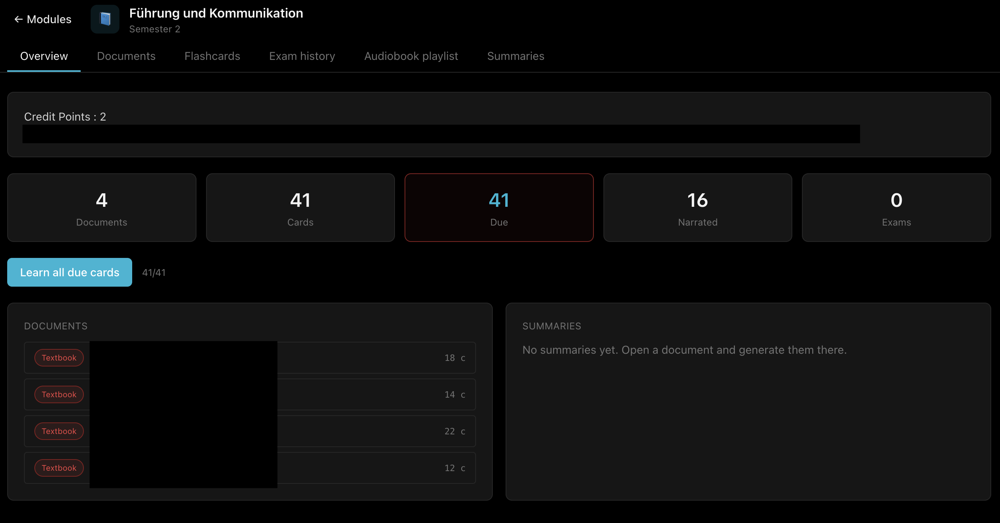
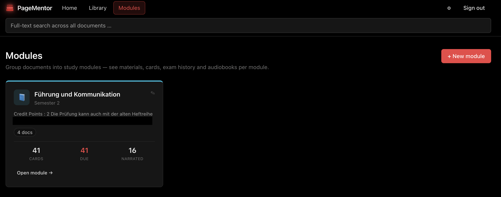

# PageMentor

<p align="center">
  
</p>

<p align="center">
  <a href="LICENSE"></a>
  
  
  
</p>

*Turn lecture PDFs into **audiobooks, flashcards and exam sessions** — entirely on
your own hardware. No cloud, no API credits, no subscription.*

> Personal hobby project for data-obsessed self-hosters. Provided as-is, with no
> warranties or support guarantees. Not intended for commercial use.

## Quickstart (TL;DR)

1. **Clone** the repo and `cp .env.example .env` — set `PM_PASSWORD`.
2. `docker compose up -d` — backend + Meilisearch (+ Docling for extraction).
3. Open `http://localhost:3100`, log in with your password.
4. **Drop a PDF in**, hit *Extract*, and watch the pipeline dots fill up.
5. Point the **Settings** page at your Ollama box and Qwen3-TTS sidecar
   (see [GPU host](#5--external-gpu-host-ollama--qwen3-tts--docling-on-cuda)) —
   both persist in `data/llm-config.json`, no container rebuild needed.

## What is it for?

Built alongside a job with a lot of time behind the wheel and an open-university
degree on the side. Reality of that combination:

- **Lecture scripts pile up faster than evenings to read them.** A ~100-page
  chapter eats a Sunday; a commute eats nothing.
- **The cloud-AI study tools out there want to host your scripts.** Some of mine
  come from a private university, some from internal training — those PDFs aren't
  going on a SaaS server.
- **And honestly: while every "AI study buddy" still routes everything through
  someone else's GPU** 🙃 I'd rather burn my own electricity.

So: drop a PDF in, and the same evening you get back an **M4B audiobook** for the
car, an **AI-generated flashcard deck** for the train and a **timed exam trainer**
for the weekend before the actual exam — all driven by a local Ollama + local TTS
stack, with cloud LLMs as optional fallback.

PageMentor is a fresh build and does not fork any existing project.


## What it does

Three things, one drag-and-drop:

### 🎧 Listen


Drop in a PDF, get back an **M4B audiobook with chapter markers** — narrated
locally by **Qwen3-TTS** (Apache 2.0). Before synthesis, a local LLM rewrites each
chapter for narration: formulas are described by meaning instead of read
symbol-by-symbol, number series are paraphrased, citations and figure references
are dropped. One-click upload to
[Audiobookshelf](https://www.audiobookshelf.org/), or subscribe as a private
podcast feed.

### 🃏 Memorise


**AI-generated flashcards + SM-2 spaced repetition.** Exercises are pulled
automatically from the chapter text, cards are generated by a local Ollama model,
and the review loop tracks your progress with keyboard shortcuts.

### 📝 Practice


**Timed exam trainer with score history.** Picks questions from your card deck,
times you, gives you a side-by-side review of your answers versus the reference —
and plots the trend as a sparkline.

## Why self-hosted

- 🔒 **Your PDFs never leave your network** — ideal for university scripts,
  internal training material, anything you don't want in a SaaS log.
- 🆓 **No API keys required** — every feature runs against a local Ollama +
  local TTS. Cloud LLMs (Anthropic / OpenAI / Google) are optional fallbacks,
  configured from the UI.
- 🏠 **One Docker stack** — runs on a Synology NAS (bind-mounted data), scales to
  a GPU workstation when you want speed.

### What you need

- **Server know-how.** This is Docker-Compose + Portainer territory. If you've
  never bind-mounted a NAS volume or opened a stack file, expect a learning curve.
- **A decent GPU** on the host that runs Ollama and Qwen3-TTS. A used RTX 3090
  (24 GB) handles the full stack comfortably; smaller cards work if you scale the
  models down.

### Tuning for your hardware

Every heavy component is swappable from the **Settings** page, so the stack scales
from a laptop to a 24 GB workstation:

- **Ollama model** — swap `llama3.2:3b` for `qwen2.5:7b`, `gemma3:27b` or whatever
  your VRAM budget allows; models pulled on the Ollama box show up automatically.
- **Qwen3-TTS voice path** — preset speakers (anchored in the model, no drift),
  voice cloning from a reference clip, or text-described voice design.
- **TTS chunk size** — max characters per synthesis request. Smaller chunks
  (1500–2500) are safer on a 12 GB card, larger chunks (3500–4000) give better
  prosody continuity on a 24 GB card.
- **Advanced TTS dials** — temperature, top-p, top-k and repetition penalty are
  exposed for all voice paths (repetition penalty is the anti-loop knob for
  long-form synthesis).

None of this requires rebuilding the container — all of it persists in
`data/llm-config.json` and survives restarts.

## More screenshots

| Learning menu (sub-tabs per document)                | Modules overview (series view)                             |
| ---------------------------------------------------- | ---------------------------------------------------------- |
|  |  |

| Modules management                       |
| ---------------------------------------- |
|  |

## Architecture


Source: [`docs/diagrams/architecture.puml`](docs/diagrams/architecture.puml).
Render with `plantuml -tpng docs/diagrams/architecture.puml -o ../screenshots`.

<details>
<summary>Deeper diagrams — pipeline + GPU arbitration</summary>

### Document processing pipeline


Source: [`docs/diagrams/pipeline.puml`](docs/diagrams/pipeline.puml).

### GPU arbitration (Ollama ↔ Qwen3-TTS on one card)


Source: [`docs/diagrams/gpu-arbiter.puml`](docs/diagrams/gpu-arbiter.puml).

</details>

## Full feature list

- **Library** — card grid with type/tag/module filters, pipeline-dot dashboard per
  document (text → chapters → audio → cards → summary), live SSE status, cover
  rendered from any page you choose.
- **Modules & tags** — organise by module (series) + free-form tags, instead of a
  folder tree.
- **PDF viewer** — continuous scroll, zoom, page jump, text-selection → flashcard.
- **Text extraction** — [Docling](https://github.com/docling-project/docling-serve)
  sidecar with OCR for scanned pages; force-OCR rescue mode for PDFs whose text
  layer is glyph soup.
- **Chapter detection** — heading heuristic + page-slice fallback, long chapters
  auto-split, inline editor (rename, merge, delete).
- **Audio cleanup** — two-stage. A deterministic pre-pass strips watermarks,
  running heads, captions and inline references and expands abbreviations. Then a
  local LLM rewrites for narration: formulas described by meaning (never read
  symbol-by-symbol), number series paraphrased, exercises removed, loop-triggering
  repetition patterns broken up. Cached per chapter (`chapters.audio_text`) —
  regeneration is free.
- **Audiobook (Qwen3-TTS)** — local
  [Qwen3-TTS](https://huggingface.co/Qwen) sidecar (12Hz 1.7B, Base + CustomVoice)
  behind `pm-gpu-arbiter`, which serialises GPU access with Ollama. Preset
  speakers are anchored in the model and never drift between chunks; custom
  voices and text-described voice designs are managed from the Settings page.
- **Voice cloning (optional)** — upload a short reference clip and the Base model
  clones the voice; a ~10 s reference is generated and cached for stable narrator
  quality across chapters.
- **Audio output** — EBU R128 loudness normalisation, MP3 per chapter and a
  complete M4B with chapter markers, cover and ID3 tags
  (title / author / album / series / grouping).
- **Audiobookshelf integration** — one-click upload of the finished M4B (with
  cover) to a configured [Audiobookshelf](https://www.audiobookshelf.org/)
  library; the backend resolves the freshly scanned item and patches
  subtitle / series / description cleanly.
- **Send to Apple** — M4B download for Apple Books, private RSS feed for Apple
  Podcasts / Overcast / Pocket Casts (token derived from `PM_PASSWORD`).
- **Flashcards** — task extraction from chapter text, AI generator via local
  Ollama, SM-2 spaced repetition with hints, CSV export/import (Anki-compatible).
- **Exam trainer** — timed sessions with self-assessment, side-by-side review and
  a sparkline-chart score history.
- **Summaries** — Ollama-powered, three detail levels per chapter, streaming
  output, document-language aware.
- **Tutor (RAG chat)** — ask questions across your whole library or a single
  module; answers cite their sources, and a click on a source opens the PDF at
  the cited page.
- **Full-text search** — Meilisearch over documents and chapters with in-place
  highlights.
- **Embeddings** — `jina-embeddings-v3` served by an
  [infinity](https://github.com/michaelfeil/infinity) sidecar on the GPU host;
  chunk-based per-document retrieval feeds the tutor and AI cards.
- **GPU manager** — a *GPU reset* button flushes all Ollama models and restarts
  the TTS container to reclaim VRAM between long runs.
- **Logs page** — live backend log stream in the UI, with noise filters for
  sidecar health checks.
- **i18n** — English + German UI, auto-detects browser language, override
  persists in settings.

## Deployment on Synology / Portainer

The compose file uses bind mounts under `/volume1/docker/pagementor/…` so your
uploads, SQLite database and generated audio survive container rebuilds and are
visible through File Station.

### 1 — Prepare the folders (one-off)

SSH into the NAS or use File Station and create:

```bash
mkdir -p /volume1/docker/pagementor/data
mkdir -p /volume1/docker/pagementor/meili
mkdir -p /volume1/docker/pagementor/docling-cache
```

### 2 — Portainer Stack

1. **Stacks → Add stack → Web editor**
2. **Name:** `pagementor`
3. Paste the contents of [`docker-compose.yml`](docker-compose.yml) — it ships
   pre-configured with the Synology bind mounts.
4. **Environment variables → Advanced mode** — paste and tweak:

   ```env
   PM_PORT=3100
   PM_PASSWORD=change-me-to-something-long
   MEILI_MASTER_KEY=change-me-to-a-long-random-key
   ```

5. **Deploy the stack.**

The image is pulled from `ghcr.io/theingof/pagementor:latest`. The package is
public, so no registry token is required for `docker pull`.

After the first successful deploy, open `http://NAS-IP:3100`, log in with the
`PM_PASSWORD` you set, and upload a PDF.

### 3 — Updating

When a new push lands on `main`, GitHub Actions builds a new image. In Portainer,
open the stack and click **Update** (with "Pull the latest images" enabled). All
your data lives on the bind-mounted folders and stays intact.

### 4 — LLM / TTS endpoints

All AI endpoints are configured **in the app, not in ENV**: open the Settings
page and fill in whichever you have — Ollama URLs (up to three boxes), the
Qwen-TTS arbiter URL, the embedding server URL, and optional cloud API keys.
Everything persists to `$PM_DATA_DIR/llm-config.json`. The LLM chain tries
PC-Ollama → Mac-Ollama → generic Ollama → cloud fallbacks → none; the first
reachable endpoint wins. If nothing responds, the AI tabs show a "not configured"
hint and the rest of the app keeps working.

### 5 — External GPU host (Ollama + Qwen3-TTS + Docling on CUDA)

For real throughput (large LLMs, voice cloning, GPU OCR), run the heavy sidecars
on a separate NVIDIA box. A complete example compose lives at
[docker-compose.gpu-host.example.yaml](docker-compose.gpu-host.example.yaml):

```bash
# on the GPU host:
curl -fLO https://raw.githubusercontent.com/TheInGoF/PageMentor/main/docker-compose.gpu-host.example.yaml
mv docker-compose.gpu-host.example.yaml docker-compose.yaml
# edit DOCLING_SERVE_API_KEY to match your NAS .env
docker compose pull
docker compose up -d
```

That brings up `ollama`, `docling`, `qwen-tts` and `pm-gpu-arbiter`. PageMentor
(on the NAS) then only talks to the arbiter — it serialises GPU access between
the LLM and the TTS sidecar so both can share one card. Set the URL once in
Settings and it persists.

Images `ghcr.io/theingof/pm-gpu-arbiter` and `ghcr.io/theingof/pm-qwen-tts` are
built by the GitHub Actions workflows in this repo — you only
`docker compose pull`, never build locally.

## Local development

```bash
# prerequisites
brew install bun ffmpeg

npm run install:all                 # backend (bun) + frontend (npm)
PM_PASSWORD=devpass npm run dev     # backend :3000, frontend :5173
```

Vite proxies `/api` to `:3000`, so the app opens at `http://localhost:5173`.

## Environment variables

| Variable | Default | Purpose |
| --- | --- | --- |
| `PM_PASSWORD` | `changeme` | Login password (required) |
| `PM_PORT` | `3100` | Host port for the container |
| `PM_DATA_DIR` | `./data` | Uploads + SQLite + audio files |
| `MEILI_URL` | `http://meilisearch:7700` | Meilisearch endpoint |
| `MEILI_MASTER_KEY` | `pm-dev-key` | Meilisearch API key |
| `PM_DOCLING_URL` | `http://docling:5001` | Docling extraction sidecar |
| `PM_QWEN_TTS_URL` | *(empty)* | Fallback TTS URL when Settings is empty |
| `PM_TEI_URL` | *(empty)* | Embedding server (infinity, jina-v3) |

Meilisearch is optional (full-text search disables itself if missing). Everything
else AI-related is configured from the Settings page (see above).

## Stack

- **Backend:** Bun + Hono + SQLite (TypeScript throughout, no Python in the app)
- **Frontend:** Vite + React 19 + Tailwind (night theme, red accents)
- **TTS:** local [Qwen3-TTS](https://huggingface.co/Qwen) sidecar
  (12Hz 1.7B Base for voice cloning + CustomVoice for preset speakers), proxied
  through [pm-gpu-arbiter](pm-gpu-arbiter/)
- **Text extraction:** [Docling-Serve](https://github.com/docling-project/docling-serve) sidecar
- **Search:** Meilisearch
- **LLM:** Ollama (self-hosted) — also drives the audio text preprocessor before
  TTS; optional cloud fallbacks (Anthropic / OpenAI / Google) via API keys
- **Embeddings:** `jina-embeddings-v3` via an
  [infinity](https://github.com/michaelfeil/infinity) sidecar (1024-dim, stored
  as Float32 BLOBs in SQLite)
- **Audio:** FFmpeg (loudnorm + M4B chapters, invoked as subprocess)

## Project structure

```text
backend/src/
  index.ts              # Hono app, routing, Meilisearch bootstrap
  auth.ts               # cookie-based password auth
  db.ts                 # SQLite schema
  lib/i18n.ts           # Accept-Language → error dictionaries
  routes/               # documents, chapters, audio, cards, exam, search,
                        # summaries, tutor, rag, modules, admin, voices, feed
  services/             # pipeline, cleanup, audiobook, audio preprocess,
                        # card generation, SM-2, embeddings, docling, events
  tts/                  # voice catalog, presets, segmenter, ffmpeg,
                        # engines/qwen

frontend/src/
  App.tsx               # router + auth gate
  components/           # Library, LearningMenu, PdfViewer, Audiobook, Cards,
                        # CardReview, ExamTrainer, Summaries, TutorPage,
                        # Dashboard, ModuleDetail, SettingsPage, LogsPage,
                        # SearchOverlay, UploadModal, ui/*
  lib/api.ts            # typed API client
  lib/i18n.ts           # useLocale hook + EN/DE dictionaries
  lib/settings.ts       # localStorage settings store
```

## Acknowledgements

Huge thanks to the authors of the open-source tools this project stands on top
of — in particular **Qwen3-TTS**, **Ollama**, **Docling**, **Meilisearch**,
**react-pdf**, **pdfjs-dist** and **FFmpeg**.

PageMentor is a fresh build and does not fork any existing project.

## On LLM use

Built human-in-the-loop with an LLM: the idea, architecture and every design
decision are human, the implementation is largely model-written from targeted,
well-scoped prompts. Every change was reviewed before merging.

## License

**GNU Affero General Public License v3.0** — see [LICENSE](LICENSE).

All third-party dependencies are either MIT, Apache 2.0 or LGPL-2.1-linked, all
AGPLv3-compatible. See [NOTICE](NOTICE) for the full attribution list.

---

[](https://ko-fi.com/lordvonbaum)

> Donations are voluntary and solely support the project. They do not influence
> the prioritisation of bugs, feature requests or support enquiries.
