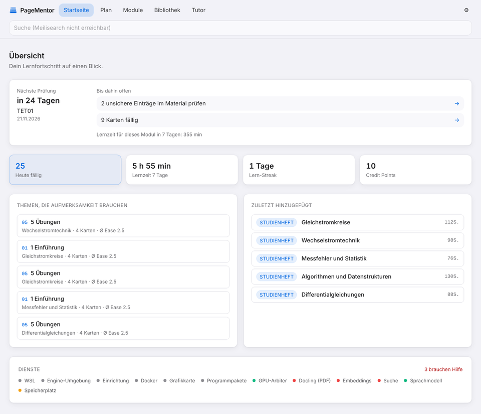
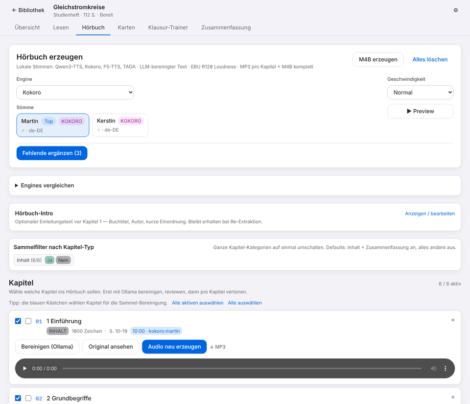
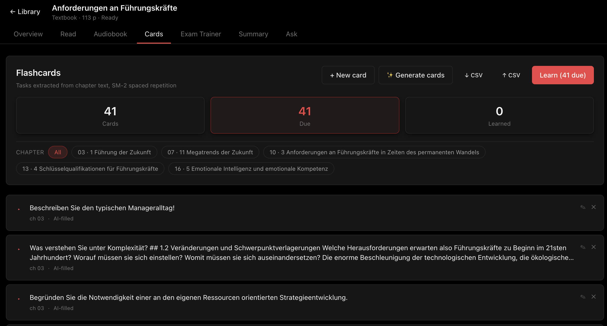
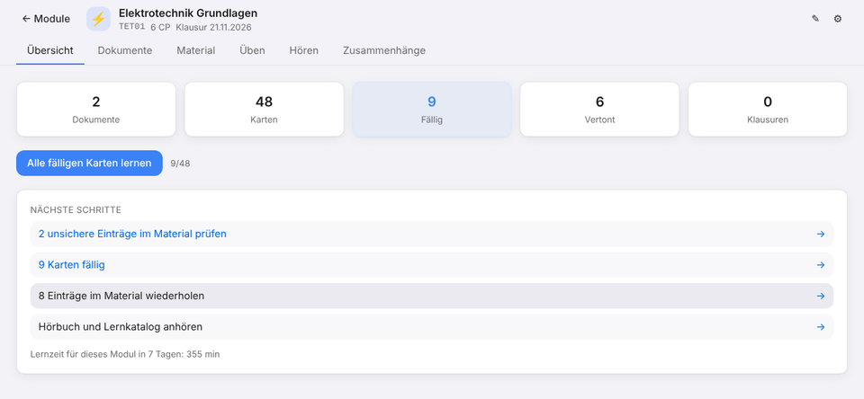
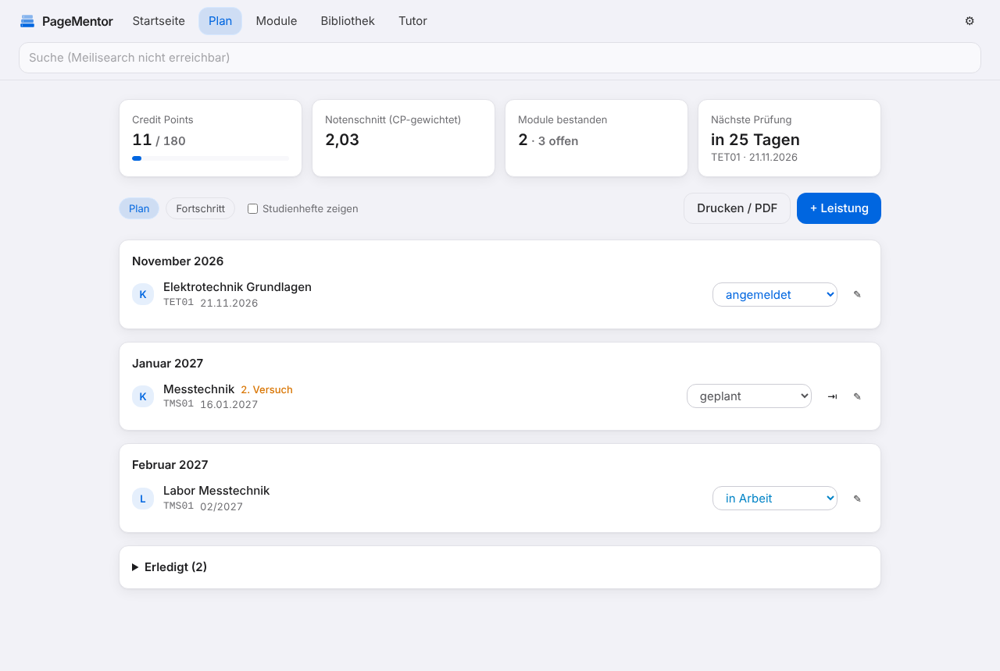
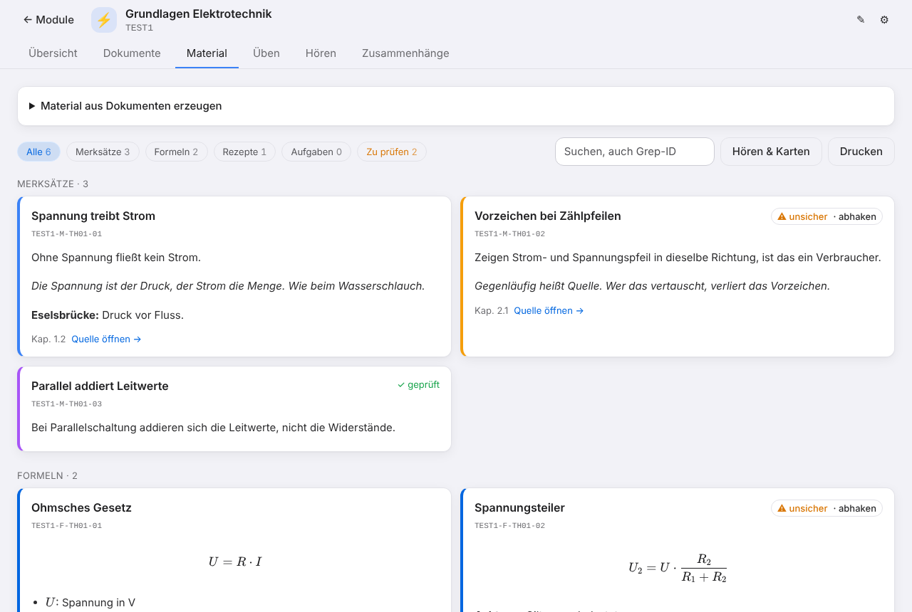
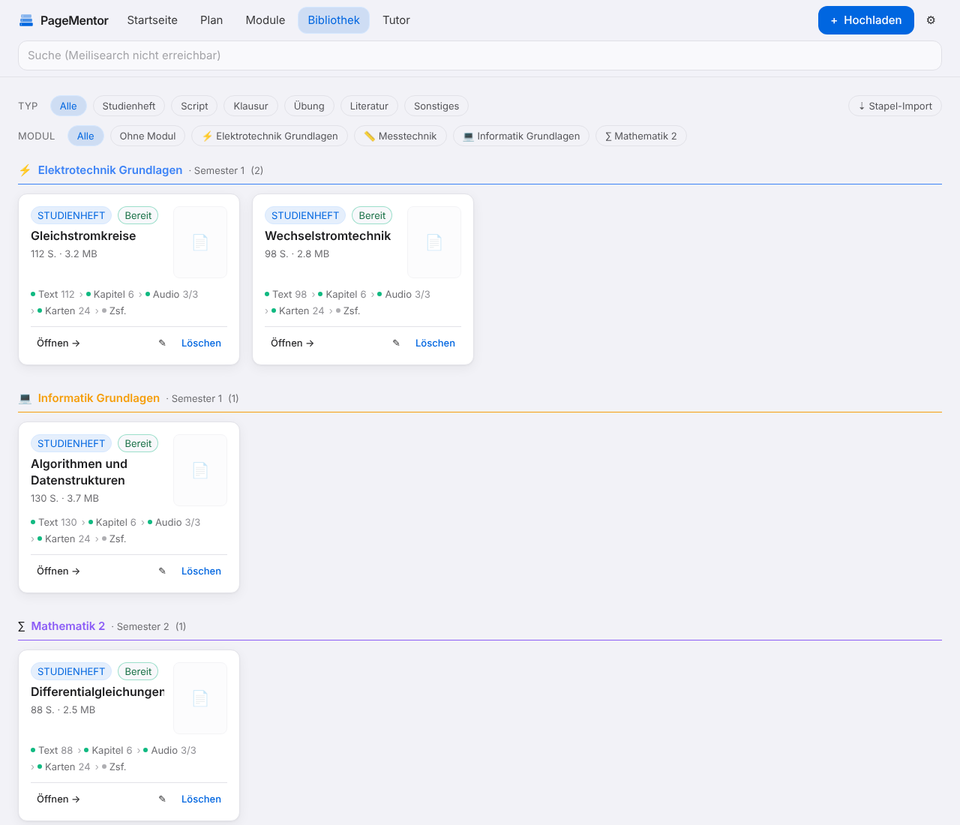
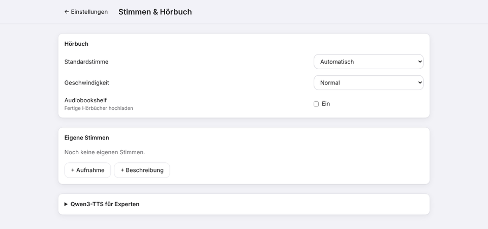
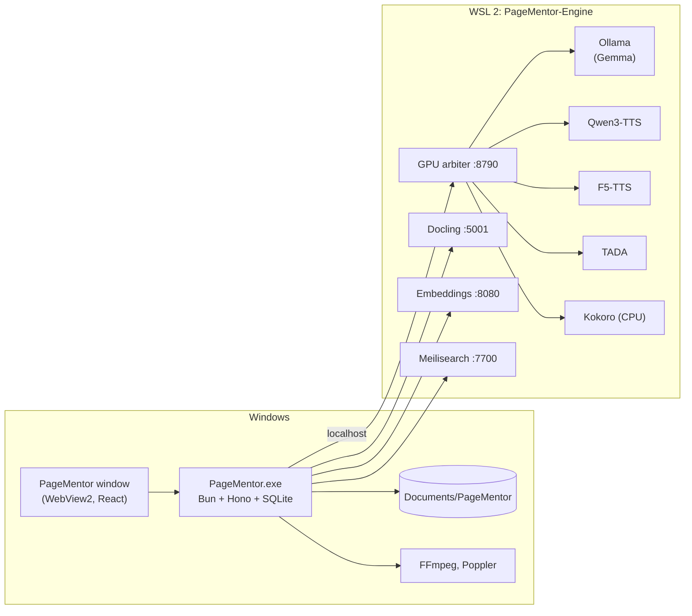
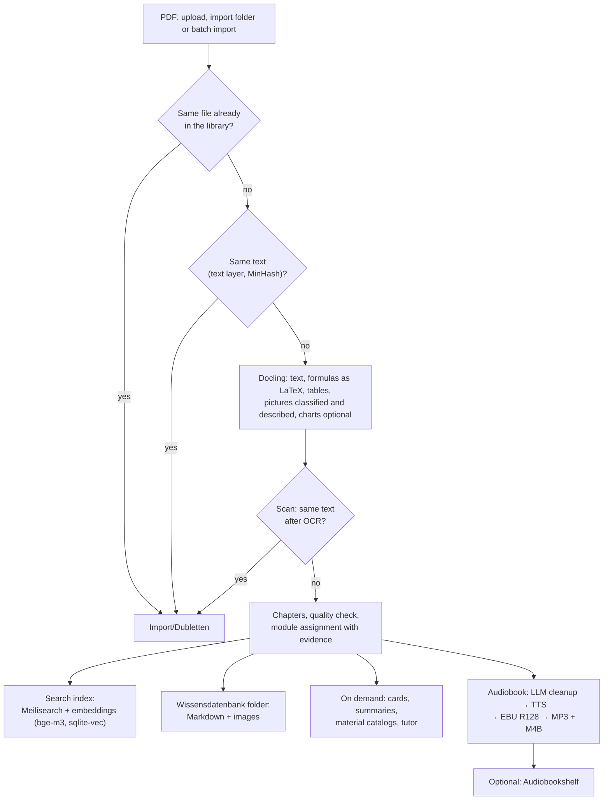

# PageMentor

<p align="center">
  
</p>

<p align="center">
  <a href="LICENSE"></a>
  
  
  
</p>

*Turn lecture PDFs into **audiobooks, flashcards and exam sessions**, keep your
**whole degree** in one place — plan, study material, task trainers and a searchable
knowledge base — entirely on your own Windows PC. No cloud, no API credits, no
subscription.*

> Personal hobby project. Provided as-is, with no warranties or support
> guarantees. Not intended for commercial use.

## Quickstart

1. Download `PageMentor-Setup-<version>.exe` and run it. No admin rights needed,
   except once for switching on WSL (Windows asks).
2. PageMentor opens in its own window. On the first start it sets up its AI
   engine in the background (WSL, Docker, models, about 30 GB with the default
   Kokoro voices) and shows the progress under **Settings → Engine**.
3. **Drop PDFs into `Documents\PageMentor\Import`** (or upload them in the
   library) and watch the pipeline dots fill up.

Everything lives in the data folder, `Documents\PageMentor` unless you pick
another one in the setup (the setup offers to move existing data). The program
folder is selectable too; the engine disk lives inside it, so both can go to a
second drive:

| Folder | Contents |
| --- | --- |
| `Import` | Drop PDFs here; read every two minutes. Processed files move to `Import\Erledigt`, duplicates to `Import\Dubletten` |
| `Wissensdatenbank` | One folder per document: Markdown with formulas as LaTeX and the images as files, readable by other tools |
| `Hörbücher` | Finished audiobooks (M4B) |
| `logs` | App, startup and engine logs, diagnostic bundles |

## What is it for?

Built alongside a job with a lot of time behind the wheel and an open-university
degree on the side. Reality of that combination:

- **Lecture scripts pile up faster than evenings to read them.** A ~100-page
  chapter eats a Sunday; a commute eats nothing.
- **The cloud-AI study tools out there want to host your scripts.** Some of mine
  come from a private university, some from internal training — those PDFs aren't
  going on a SaaS server.
- **And honestly: while every "AI study buddy" still routes everything through
  someone else's GPU** 🙃 I'd rather burn my own electricity.

So: drop a PDF in, and the same evening you get back an **M4B audiobook** for the
car, an **AI-generated flashcard deck** for the train and a **timed exam trainer**
for the weekend before the actual exam — all driven by local models on your own
Windows PC, with cloud LLMs as optional fallback.

PageMentor is a fresh build and does not fork any existing project.



## What it does

Four things around one library:

### 🎧 Listen



Drop in a PDF, get back an **M4B audiobook with chapter markers**, narrated
locally. Before synthesis, a local LLM rewrites each chapter for narration:
formulas are described by meaning instead of read symbol-by-symbol, number series
are paraphrased, citations and figure references are dropped. Kokoro is installed by default; the other engines are optional. Pick the
engine per book and compare them side by side:

| Engine | Voices | Runs on |
| --- | --- | --- |
| **Kokoro** (German, default) | Martin, Kerstin, very fast | CPU |
| **Qwen3-TTS** | presets, your own voice samples, text-described designs | GPU |
| **F5-TTS German** | clones your voice samples | GPU |
| **TADA 3B** | clones your voice samples | GPU |

Optional one-click upload to [Audiobookshelf](https://www.audiobookshelf.org/),
switched off by default.

### 🃏 Memorise



**AI-generated flashcards + SM-2 spaced repetition.** Exercises are pulled
automatically from the chapter text, cards are generated by a local model, and the
review loop tracks your progress with keyboard shortcuts.

### 📝 Practice

**Timed exam trainer with score history.** Picks questions from your card deck,
times you, gives you a side-by-side review of your answers versus the reference —
and plots the trend as a sparkline.

### 🎓 Study



**One app for the whole degree.** Five areas: *Start · Plan · Modules · Library · Tutor*.

- **Plan** — assessments by month with status, attempts and grades, CP-weighted
  average, known and estimated (TBA) exam dates, *move with follow-ups* when an
  exam is postponed, and study time as a heatmap.
- **Material** — key rules, formulas, recipes and exam tasks per module, each with
  a grep-able ID. Extracted from your booklets by the local model with a JSON
  schema; uncertain entries are flagged until you tick them off. Read them aloud
  as an audiobook (formulas spoken as words) or learn them as flashcards.
- **Task trainer** — your own task generators run sandboxed in the app; solutions
  are revealed step by step with KaTeX and jump into the booklet chapter.
- **Knowledge base** — hybrid search (full text + vectors in SQLite via
  sqlite-vec) over all booklets and literature, an import folder, batch import
  with a resumable night queue, duplicate detection before any conversion, test
  questions that measure the hit rate, and a map of related chapters across
  booklets.





## Why local

- 🔒 **Your PDFs never leave your PC** — ideal for university scripts, internal
  training material, anything you don't want in a SaaS log.
- 🆓 **No API keys required** — every feature runs against local models. Cloud
  LLMs (Anthropic / OpenAI / Google) are optional, configured from the UI. The
  optional *cloud help* (review, second opinion, failure diagnosis) shows you the
  exact text before anything is sent and sends nothing without your click.
- 🪟 **One installer** — the app sets up and checks its own AI engine. No
  terminal, no Docker commands.

### What you need

- **Windows 10 22H2 or Windows 11**, 64-bit.
- **An NVIDIA graphics card** with a current driver. 12 GB VRAM works with smaller
  models, 24 GB (e.g. a used RTX 3090) runs everything comfortably.
- **About 80 GB free disk space** for models and the engine environment.
- **Internet** for the first setup and for updates.

### Tuning for your hardware

Every heavy component is swappable from the **Settings** page:

- **Language model** — `gemma4:e4b` by default; swap for a bigger or smaller
  Ollama model as your VRAM allows.
- **Voice engines** — Kokoro (CPU) is always installed; switch Qwen3-TTS
  (~12 GB), F5-TTS (~9 GB) and TADA (~10 GB) on under *Settings → Engine →
  Voice engines*. TADA needs a Hugging Face token with Llama 3.2 access.
- **Own voices** — upload a short recording with its transcript under
  *Settings → Voices & audiobook*; Qwen, F5-TTS and TADA clone it. TTS chunk
  size and the Qwen dials live under *Qwen3-TTS for experts* on the same page.



## How it works



- **The app** is one executable. It serves the UI on `127.0.0.1:3100` and shows
  it in its own window. Nothing listens on the network.
- **The engine** is a private WSL distribution with Docker inside. The app imports
  it from the official Ubuntu image, installs Docker and the NVIDIA toolkit, pulls
  the service images and keeps it running. A self-test under *Settings → Engine*
  checks every step and offers a repair button for each problem.
- **The GPU arbiter** keeps exactly one model in VRAM: a language-model request
  unloads the TTS engine and vice versa. Each TTS engine starts on demand.

<details>
<summary>Document processing pipeline</summary>



Docling, Ollama and the TTS engines share the GPU through the arbiter; Docling
is restarted after a few idle minutes to give its memory back.

</details>

## Full feature list

- **Library** — card grid with type/tag/module filters, pipeline-dot dashboard per
  document (text → chapters → audio → cards → summary), live status, cover rendered
  from any page you choose.
- **Modules & tags** — organise by module (series) + free-form tags, instead of a
  folder tree.
- **PDF viewer** — continuous scroll, zoom, page jump, text-selection → flashcard.
- **Text extraction** — [Docling](https://github.com/docling-project/docling-serve)
  at its highest level: German OCR for scanned pages, formulas as LaTeX (also
  when embedded as images), accurate tables, code as text, pictures classified
  and described, optionally charts converted to data points (*Settings → AI →
  PDF conversion*, needs 5–10 GB extra VRAM); force-OCR rescue mode for PDFs
  whose text layer is glyph soup.
- **Import folder & duplicates** — drop PDFs into `Documents\PageMentor\Import`.
  Before any expensive step the app compares the file fingerprint and the text
  (MinHash, from the text layer or after OCR for scans); duplicates are set aside
  without conversion.
- **Readable knowledge base** — every document is also written to
  `Documents\PageMentor\Wissensdatenbank` as Markdown with front matter and its
  images as files.
- **Chapter detection** — heading heuristic + page-slice fallback, long chapters
  auto-split, inline editor (rename, merge, delete).
- **Audio cleanup** — a deterministic pre-pass strips watermarks, running heads,
  captions and inline references and expands abbreviations. Then a local LLM
  rewrites for narration. Cached per chapter — regeneration is free.
- **Audiobook** — four local engines (table above; Kokoro with Martin and
  Kerstin as default), engine picker per book and an *all in sequence*
  comparison that reads the same excerpt with every engine.
- **Voice cloning** — upload a short reference clip with its transcript; Qwen,
  F5-TTS and TADA clone it. Two freely licensed German templates ship with the
  app so the cloning engines have voices from the start: *Thorsten*
  ([Thorsten-Voice](https://www.thorsten-voice.de), CC0) and *Hokuspokus*
  (CSS10/LibriVox, public domain). Qwen voice designs get a cached reference so the other
  engines can clone them too.
- **Audio output** — EBU R128 loudness normalisation, MP3 per chapter and a
  complete M4B with chapter markers, cover and tags.
- **Audiobookshelf integration** — optional, off by default. One-click upload of
  the finished M4B to a configured library.
- **Flashcards** — task extraction from chapter text, AI generator, SM-2 spaced
  repetition with hints, CSV export/import (Anki-compatible).
- **Exam trainer** — timed sessions with self-assessment, side-by-side review and
  score history.
- **Summaries** — three detail levels per chapter, streaming output,
  document-language aware.
- **Tutor (RAG chat)** — ask questions across your whole library or a single
  module; answers cite their sources and open the PDF at the cited page.
- **Full-text search** — Meilisearch over documents and chapters.
- **Study plan** — assessments, attempts (max. three), grades, CP and CP-weighted
  average, exam dates incl. estimated ones, move-with-follow-ups, print or PDF.
- **Study time** — booked automatically while you practise or review cards, heatmap
  and per-module totals.
- **Module assignment with evidence** — a document joins a module only if its file
  name or first page carries the module code or a known booklet prefix; otherwise
  it waits under *No module* with a suggestion. Prefixes are edited per module.
- **Quality check** — after each conversion: lost formulas, characters per page,
  empty table cells, OCR fragments.
- **Material catalogs** — extraction per section with schema, cache and retry;
  review list for uncertain entries; *listen & cards* from rules and formulas.
- **Task trainer** — sandboxed generator files with a self-test (structure, 200
  random runs, exam vectors, booklet references).
- **Knowledge base** — sqlite-vec + FTS5, reciprocal rank fusion, batch import
  (recursive, resumable, night mode, ETA, adopts existing Docling Markdown),
  literature as its own type, test questions with hit rate and MRR, chapter map.
- **Import from Studium Maker** — modules, exam dates, assessments, study time,
  catalogs, trainers and the module map, with a dry run first.
- **Cloud help (optional)** — review of catalog entries, recipe synthesis, second
  opinion in the tutor, diagnosis of failed local runs; preview and consent before
  every send, everything logged.
- **Diagnostics** — app, startup and engine logs in `Documents\PageMentor\logs`,
  a live log view and a one-click *diagnostic bundle* (ZIP) for bug reports.
- **Appearance** — light and dark theme (follows Windows), three accent palettes.
- **i18n** — English + German UI.

## Coming from Studium Maker

*Settings → General → Import from Studium Maker*: pick your Studium Maker folder,
run the **preview**, check the report (CP and average should match the old
planner), then **import**. Running it again creates no duplicates. Your data is
copied into `Documents\PageMentor`; the old folder stays untouched and can be
archived once you're happy. Already converted booklets (`10_temp/md`) can be
adopted via *Library → Batch import* instead of converting them again.
A German walkthrough is in [docs/HILFE.md](docs/HILFE.md).

## Troubleshooting

1. Open **Settings → Engine** and run the **self-test**. Every failed step comes
   with an explanation and, where possible, a *Repair* button.
2. Still stuck? **Settings → Diagnostics → Create diagnostic bundle** writes a ZIP
   with logs, self-test results and versions (no keys or passwords) to
   `Documents\PageMentor\logs`. Attach it to your bug report.

Uninstalling keeps `Documents\PageMentor`. The uninstaller asks whether to remove
the engine environment (models and images) as well.

## Development

```bash
# prerequisites: bun, node 22, ffmpeg, poppler
npm run install:all
npm run dev            # backend :3100, frontend :5173 (proxies /api)
scripts/check-all.sh   # line limits, typecheck, tests, smoke test, build
```

The AI services can run on any Docker host with an NVIDIA GPU:
`docker compose -f engine/compose.yaml up -d`, then point the app at it with
`PM_ENGINE_HOST=<host>`.

Build the Windows package (CI does this on every push):

```bash
scripts/build-windows.sh            # dist/PageMentor (exe, tools, UI, engine scripts)
ISCC packaging/windows/PageMentor.iss
```

## Environment variables

All optional; the installed app needs none.

| Variable | Default | Purpose |
| --- | --- | --- |
| `PM_DATA_DIR` | `Documents\PageMentor` (Windows), `./data` | Uploads, SQLite, audio, logs |
| `PORT` | `3100` | Local port |
| `PM_HOST` | `127.0.0.1` | Bind address |
| `PM_ALLOW_REMOTE` | *(off)* | `1` allows requests from other hosts |
| `PM_ENGINE_HOST` | `localhost` | Host of the AI services |
| `PM_ENGINE_AUTOSTART` | `1` | `0` disables automatic engine setup and repair |
| `PM_IMPORT_DIR` | `<data>\Import` | Folder that is read automatically |
| `PM_KNOWLEDGE_DIR` | `<data>\Wissensdatenbank` | Readable copy of every document |
| `PM_DOCLING_URL` | `http://<engine host>:5001` | Docling server |
| `PM_UI` | `window` | `window`, `browser` or `none` |
| `PM_SQLITE_VEC` | *(next to the exe)* | Path to the sqlite-vec extension |
| `PM_CLOUD_CLAUDE_MODEL` | `claude-opus-5-5` | Model for the optional cloud help |

Everything AI-related is configured from the Settings page and stored in
`llm-config.json` in the data folder.

## Stack

- **App:** Bun + Hono + SQLite (FTS5 + sqlite-vec for the knowledge base), compiled to one Windows executable; UI in React 19
  + Vite + Tailwind, shown via WebView2
- **Engine:** WSL 2 + Docker: Ollama, Docling-Serve, infinity (bge-m3),
  Meilisearch, the TTS sidecars and [pm-gpu-arbiter](pm-gpu-arbiter/)
- **TTS sidecars:** [pm-qwen-tts](pm-qwen-tts/), [pm-kokoro-tts](pm-kokoro-tts/),
  [pm-f5-tts](pm-f5-tts/), [pm-tada-tts](pm-tada-tts/) on a shared base
  ([pm-tts-common](pm-tts-common/))
- **Audio:** FFmpeg (loudnorm + M4B chapters, invoked as subprocess)
- **Installer:** Inno Setup, per-user, no admin rights

## Project structure

```text
backend/src/
  index.ts      # Hono app, routing
  launch.ts     # app window, single instance, quit
  desktop/      # WebView2 window (worker) + Win32 helpers
  engine/       # WSL engine: self-test, repairs, autostart
  log/          # structured logs, diagnostic bundle
  routes/       # documents, chapters, audio, cards, exam, search, tutor, …
  services/     # pipeline, cleanup, audiobook, card generation, embeddings, …
    rag/        #   vector index, full text, hybrid search, test questions, chapter map
    batch/      #   batch import queue, adopting Docling Markdown
    cloud/      #   optional cloud help with consent
  study/        # modules, assessments, plan, study time, material, trainers, import
  tts/          # voice catalog, segmenter, ffmpeg, engines (qwen, extra)
frontend/src/
  components/   # pages, plan/, module/, practice/, settings/, engine/, audiobook/, ui/
  lib/          # API client, i18n, theme
engine/         # compose.yaml + provision.sh for the WSL environment
packaging/      # Windows installer
pm-*/           # sidecars: GPU arbiter, TTS engines, Docling with German OCR
docs/           # German help (HILFE.md), screenshots
archive/        # no longer used: NAS deployment, audio analyzer, old plans and screenshots
```

## Acknowledgements

Huge thanks to the authors of the open-source tools this project stands on top
of — in particular **Qwen3-TTS**, **Kokoro**, **F5-TTS**, **TADA**, **Ollama**,
**Docling**, **Meilisearch**, **react-pdf**, **pdfjs-dist**, **FFmpeg** and **WebView2**.

PageMentor is a fresh build and does not fork any existing project.

## On LLM use

Built human-in-the-loop with an LLM: the idea, architecture and every design
decision are human, the implementation is largely model-written from targeted,
well-scoped prompts. Every change was reviewed before merging.

## License

**GNU Affero General Public License v3.0** — see [LICENSE](LICENSE).

All bundled third-party code is MIT, Apache 2.0 or LGPL-2.1-linked, all
AGPLv3-compatible. Some optional models have their own terms (F5-TTS German:
CC-BY-NC 4.0, TADA: Llama 3.2 Community License); they are downloaded at runtime
and never bundled. See [NOTICE](NOTICE) for the full attribution list.

---

[](https://ko-fi.com/lordvonbaum)

> Donations are voluntary and solely support the project. They do not influence
> the prioritisation of bugs, feature requests or support enquiries.
